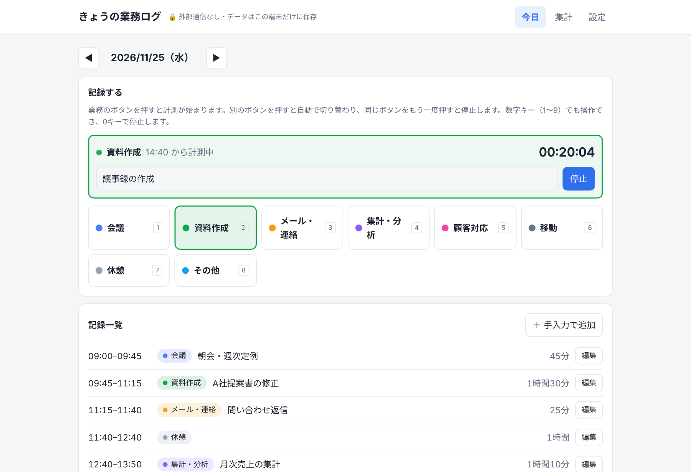

# きょうの業務ログ

ボタンを押すだけで業務の時間を記録し、**日報の下書きまで自動で作る**ツールです。
インストール不要。ブラウザで開くだけで使えます。

## ▶ 使ってみる

**https://YOUR-NAME.github.io/worklog/**

<!-- 公開後、YOUR-NAME をGitHubのユーザー名に書き換えてください -->

## できること

- **ワンクリックで計測**：業務のボタンを押すと計測開始。別のボタンを押すと自動で切り替わります
- **キーボード操作**：数字キー 1〜9 で業務を選び、0 で停止
- **メモ付きの記録**：「何をしていたか」を残せます
- **日報の自動作成**：その日の記録から、業務ごとの時間・内容をまとめた日報の下書きを作ります
- **週・月の集計**：日ごとの実働時間グラフと、業務ごとの内訳・割合
- **CSV出力**：Excelでそのまま開けます（工数報告に）
- **業務の種類を自由に設定**：名前・色・並び順、実働に含めるかどうか

## 🔒 セキュリティ

業務で安心して使えるよう、次のように作っています。

- **外部と一切通信しません。** ブラウザの機能（Content Security Policy）で通信そのものを禁止しています
- **データはお使いのブラウザの中だけに保存されます。** サーバーやAIに送られることはありません
- 外部のライブラリやフォントも読み込んでいません（このHTMLファイル1つで完結）
- CSV出力時は、Excelで数式として実行されないよう対策しています

さらに安心して使いたい場合は、`index.html` をPCに保存し、ネットにつながっていない状態で開いても同じように動きます。

## 使い方

1. 業務を始めたら、その業務のボタンを押す
2. 必要なら「何をしているか」を入力する
3. 次の業務に移るときは、そのボタンを押す（自動で切り替わります）
4. 終業時に「停止」を押し、「日報の下書き」をコピーする

押し忘れた記録は、「＋ 手入力で追加」や各記録の「編集」で直せます。

## データの保存について

- 記録はブラウザごとに保存されます。別のPCやブラウザでは共有されません
- ブラウザの履歴・データを消去すると記録も消えます。ときどき「設定」→「バックアップを書き出す」で保存してください
- PCを変えるときは、バックアップファイルを新しいPCで読み込んでください

## 動作環境

Chrome / Edge の最新版で動作を確認しています。スマートフォンのブラウザでも使えます。

## 関連リンク

- 作品一覧（Notion）：準備中
- 高機能版：準備中

## 利用条件

- 個人・社内での利用は無料・自由です。自分用の改変もご自由にどうぞ
- このツールの再配布・販売はご遠慮ください
- 本ツールの利用によって生じた損害について、作者は責任を負いません

---

作者：YOUR-NAME ／ ご意見・不具合報告は [Issues](../../issues) からどうぞ
